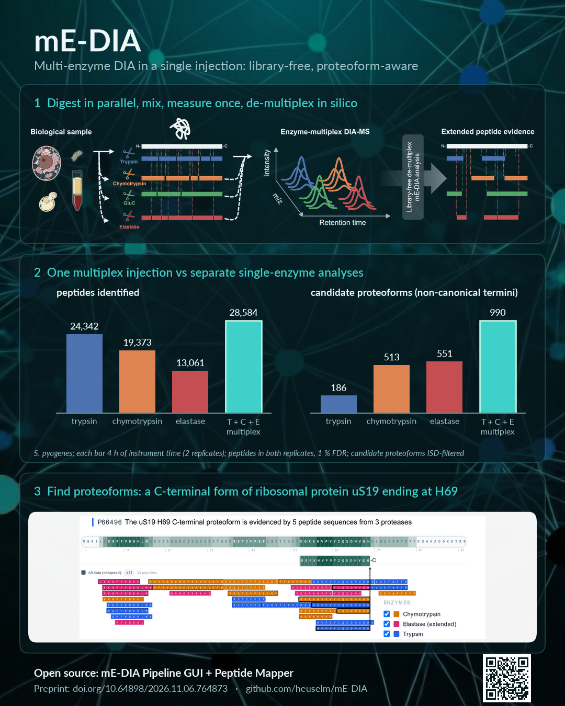

# mE-DIA

**Multi-enzyme DIA in a single injection: library-free, proteoform-aware. Powered by DIA-NN.**

<p align="center">
  <a href="docs/img/overview_dark.pdf"></a>
</p>

mE-DIA splits a protein sample across several proteases, pools the digests, and measures
them in a **single DIA-MS injection**. The analysis, from FASTA to quantification matrices
and candidate proteoforms, runs **without DDA runs**. It uses *in silico* spectral library
prediction plus empirical correction from the DIA data itself.

---

## Highlights

* **Coverage gain**: substantially more unique peptides and amino-acid sequence coverage
  than single-enzyme DIA, at no extra instrument time.
* **Proteoform-aware**: an optional semi-specific extension surfaces non-canonical peptide
  termini (endogenous proteolytic processing). Candidate proteoform events are called with an
  in-source-decay filter.
* **Accessible**: the full workflow runs from a Windows GUI (`mEDIA.exe`), and results are
  explored in an interactive Peptide Mapper. No command-line expertise required.

---

## Workflow overview

mE-DIA accepts **multi-enzyme** DIA data (several digests pooled into one injection) as well
as **single-enzyme** data. Select one enzyme, and the same workflow runs with one pass-1
channel.

```
Sample prep
    │
Digest with N enzymes  →  pool  →  single C18 cleanup  →  one LC-MS/MS DIA injection
    │
PASS 1   per-enzyme search against in silico predicted, fully specific libraries
    │        ├── empirical speclib T (Trypsin)
    │        ├── empirical speclib C (Chymotrypsin)
    │        ├── empirical speclib G (GluC)
    │        └── empirical speclib E (Elastase) ...
    │
MERGE    → composite pass-1 library
    │
PASS 2   composite fully specific search  →  quantification matrices
    │
    ├──────── (optional semi-specific extension) ────────┐
    │                                                     │
PASS 3   permissive protein IDs → semi-specific library prediction,
         per-enzyme search → semi-specific empirical speclibs
    │
MERGE    → semi-extended composite library
    │
PASS 4   final search  →  proteoform analysis  →  Peptide Mapper
```

1. **Sample prep**: multiple enzyme digests are pooled before *one* C18 cleanup.
2. **Pass 1 (per enzyme)**: DIA-NN searches the DIA data against an *in silico* predicted
   library for each enzyme separately, producing per-enzyme empirical libraries.
3. **Library merging**: the per-enzyme empirical libraries are merged into one composite library.
4. **Pass 2 (composite)**: the composite library is searched against the DIA data, yielding
   the quantification matrices.
5. **Semi-specific extension (optional)**: passes 3 and 4 add semi-specific peptides, which
   reveal endogenous cleavage sites at the cost of additional run time.

Supported enzymes: Trypsin, Trypsin/P, Chymotrypsin, GluC, Elastase (standard and extended),
LysC, LysN, ArgC, AspN, CNBr and PepsinA. Custom enzymes can be added. See the
[enzyme reference](docs/command-line.md#enzymes-and-missed-cleavages).

---

## Installation

### Windows (recommended)

**a) Install DIA-NN 1.8.1**

Download and install [DIA-NN 1.8.1](https://github.com/vdemichev/DiaNN/releases/tag/1.8.1),
e.g. to `C:\DIA-NN\1.8.1\`. Keep `dia-nn-plotter.exe` next to `diann.exe`; mE-DIA uses it for
QC plots. DIA-NN is a separate program under its own license and is not bundled with mE-DIA.

**b) Download and launch `mEDIA.exe`**

Download `mEDIA.exe` from the **Assets** of the
[latest release](https://github.com/heuselm/mE-DIA/releases/latest). Optionally check it
against the `mEDIA.exe.sha256` file next to it. Put it in any folder and double-click it. The
GUI opens in your browser at http://localhost:8765/.

- The exe is self-contained (~320 MB): Python, the pipeline, the GUI and the Peptide Mapper
  are bundled. No other installation is needed.
- The first launch takes 10–20 s while the bundle unpacks.
- Windows SmartScreen may warn because the exe is unsigned: *More info → Run anyway*.
- Settings are saved to `config.json` next to the exe.

Requirements: Windows 10/11 x64, a modern browser, DIA-NN 1.8.1. Input data are `.raw` or
`.mzML` DIA files plus a FASTA protein database (UniProt format tested).

### Command line (Linux or WSL)

For running from source, scripting runs, or using the GUI from Linux or WSL. Needs
Python 3.10+ and DIA-NN 1.8.1.

```bash
sudo apt install python3-venv  # Debian/Ubuntu/WSL, once: provides venv
git clone https://github.com/heuselm/mE-DIA.git
cd mE-DIA
python3 -m venv .venv
source .venv/bin/activate
python -m pip install -r bin/requirements.txt
python bin/start.py            # starts the GUI server at http://localhost:8765/
```

The pipeline itself can also run without the GUI:
`python bin/run_pipeline.py --raw ... --fasta ... --out-dir ... --enzymes TCGE --diann /path/to/diann`.

**→ Full guide: [docs/command-line.md](docs/command-line.md)**, covering WSL specifics,
every pipeline option, modifications, enzymes and output files.

---

## Quick start: running an analysis

### mE-DIA Search

1. **⚙ DIA-NN Settings**: set the **DIA-NN executable** (e.g. `C:\DIA-NN\1.8.1\diann.exe`)
   and the number of **CPU threads**, then *Save settings*.
2. **RAW files**: add your `.raw` / `.mzML` DIA files (multi-select supported).
3. **FASTA database**: select the protein sequence database.
4. **Output directory**: choose where results are written.
5. **Enzymes**: tick the enzyme(s) whose digests were pooled in the sample. For single-enzyme
   data, tick one.
6. **Per-enzyme predicted speclib** *(optional)*: point at previously predicted libraries
   (`.predicted.speclib`) to skip prediction. This saves substantial time when reusing a
   FASTA + enzyme search space.
7. **Semi-specific extension** *(optional)*: enables passes 3 and 4 for proteoform discovery.
   It gives higher coverage but takes longer and needs more memory.
8. **Advanced peptide params** *(optional)*: peptide length range and missed cleavages
   (global default, plus per-enzyme overrides shown under the enzyme list).
9. Click **Run**. The **Terminal** tab streams progress and DIA-NN output. The **Results**
   tab summarises identifications per pass and per enzyme.

**Save / Load Settings** writes and reads a `pipeline.settings` file, so any run can be
reproduced. Every run also stores its `pipeline.settings` in the output folder. Use
**Shutdown** to stop the server.

### mE-DIA Peptide Mapper: interactive exploration of results

In the result folder, open the final pass folder (`pass4_semiExt_<ENZYMES>/` with the
semi-specific extension, otherwise `pass2_<ENZYMES>/`):

1. Open **`PeptideMapper.html`** in a browser.
2. Load **`report_annotated.tsv`** and **`report.used.fasta`** from the same folder. Drag
   and drop them onto the page, or use the import buttons in the top right.

**a) Protein-centric analysis**

1. Search for or select a protein of interest in **Protein Selection**.
2. Explore its peptide evidence: sequence coverage per enzyme and per specificity class.
3. Suggested: review candidate proteoform events listed in **`report.pf_matrix.tsv`**
   (same folder) by selecting those proteins in the Mapper.
4. Optional: assign runs to groups (**Samples → Condition**) to show peptide evidence per
   condition.

**b) Discovery-centric analysis** — *experimental*

1. Assign runs to groups (**Samples → Condition**).
2. Open **Differential Discovery**.
3. Look for proteins with a large difference in amino-acid observation frequency between
   the two conditions. The score sums, over all residues, the difference in how often each
   residue is covered by an observed peptide. It is plotted against either the protein's
   log2 fold change (mean protein-group quantity, condition 1 / condition 2) or its mean
   protein-group quantity across both conditions. A high score at a small fold change
   suggests a change in processing rather than in abundance, i.e. a candidate
   condition-specific proteoform. Only proteins observed in both conditions are scored. The
   score is not normalised for protein length, so long proteins tend to score higher.

> ⚠️ **Experimental feature.** Differential Discovery is a hypothesis-generating view. It has
> not been benchmarked, applies no statistical testing or FDR control to the contrast, and its
> output is not part of the published analyses. Verify any candidate with the
> protein-centric view and independent evidence.

---

## Output

Each pass writes to its own folder (`pass1_<E>/`, `pass2_<ENZYMES>/`, and with the extension
`pass3_semiExt_<E>/`, `pass4_semiExt_<ENZYMES>/`). The final pass folder holds:

| File | Contents |
|---|---|
| `report_annotated.tsv` | Main result: DIA-NN report with `Enzyme` and `Specificity` columns |
| `report.pr_matrix.tsv`, `report.pg_matrix.tsv`, … | Quantification matrices |
| `report.pf_matrix.tsv` | Candidate proteoform events (with in-source-decay flags) |
| `PeptideMapper.html`, `report.used.fasta` | Interactive Peptide Mapper and its sequences |

`pipeline.settings` at the top level records the exact settings, the mE-DIA version and the
DIA-NN version. Full list: [docs/command-line.md#output](docs/command-line.md#output).

---

## Contributing

Contributions are welcome. To keep them reviewable, every change starts with an issue.

1. **Open an issue first**, using the matching template:
   - **Feature request**: an outline of the feature, its purpose (which analysis or user it
     serves), and the proposed approach.
   - **Bug report**: what happened versus what you expected, steps to reproduce, and the
     execution environment: OS, `mEDIA.exe` or source, mE-DIA version (`mEDIA.exe --version`
     or the `buildInfo` in `pipeline.settings`), DIA-NN version, and Python version if run
     from source.
2. **Agree on the approach in the issue** before writing larger changes.
3. **Open a pull request** that references the issue (`Closes #N`) and describes:
   - the change, or the intended fix and why it fixes the bug;
   - **tests performed**: the output of the `bin/test_*.py` scripts, and for pipeline changes,
     the dataset it was run on and the before/after numbers;
   - whether results change for existing analyses.
4. Add or extend checks in `bin/test_*.py` for new behaviour. Tests are plain scripts that
   print PASS/FAIL. See [docs/command-line.md#tests](docs/command-line.md#tests).

By contributing, you agree that your contribution is licensed under the project's license
(see [License](#license)).

---

## Citation

If you use mE-DIA, please cite the preprint:

> Heusel M, Happonen L, Karlsson C, Åhrman E, Malmström J. **Multi-Enzyme Data-Independent
> Acquisition Mass Spectrometry for Proteoform-Aware Single-shot Proteomics.** *bioRxiv* 2026.
> doi:[10.64898/2026.11.06.764873](https://doi.org/10.64898/2026.11.06.764873)

GitHub's **"Cite this repository"** button (generated from `CITATION.cff`) gives BibTeX and
APA entries.

Please also cite the methods mE-DIA builds on:

1. Demichev V, Messner CB, Vernardis SI, Lilley KS, Ralser M. **DIA-NN: neural networks and
   interference correction enable deep proteome coverage in high throughput.**
   *Nat. Methods* 2020; 17:41–44.
2. Isaksson M, Karlsson C, Laurell T, Kirkeby A, Heusel M. **MSLibrarian: Optimized Predicted
   Spectral Libraries for Data-Independent Acquisition Proteomics.**
   *J. Proteome Res.* 2022; 21:535–546.
3. Searle BC, Swearingen KE, Barnes CA, Schmidt T, Gessulat S, Küster B, Wilhelm M.
   **Generating high quality libraries for DIA MS with empirically corrected peptide
   predictions.** *Nat. Commun.* 2020; 11:1548.
4. Richards AL, Chen K-H, Wilburn DB, Stevenson E, Polacco BJ, Searle BC, Swaney DL.
   **Data-independent acquisition protease-multiplexing enables increased proteome sequence
   coverage across multiple fragmentation modes.** *J. Proteome Res.* 2022; 21(4):1124–1136.

---

## Troubleshooting

| Symptom | Fix |
|---------|-----|
| `diann` not found | Set the full path to `diann.exe` under *DIA-NN Settings*, or pass `--diann` |
| Windows SmartScreen blocks `mEDIA.exe` | The exe is unsigned: *More info → Run anyway* |
| Port 8765 already in use | Click **Shutdown** in the running GUI, or start with `--port` (source install) |
| Browser shows nothing on port 8765 (source install) | Rebuild the GUI: `python bin/start.py --build-ui` (needs Node.js 18+) |
| `error: externally-managed-environment` from `pip` | Use a virtual environment, as in [Command line](#command-line-linux-or-wsl) |
| `No module named fastapi` after installing | `pip` and `python` are different interpreters: activate the venv and use `python -m pip install -r bin/requirements.txt` |
| `xdg-open: no method available` (WSL) | Harmless: open http://localhost:8765 in the Windows browser |
| DIA-NN aborts with "not enough memory" during library prediction | The search space is too large for the machine's RAM: reduce variable modifications or missed cleavages, or increase the Windows page file |

---

## Development and AI assistance

Development of this repository was supported by AI coding assistants used through the
[Claude Code](https://claude.com/claude-code) harness: Anthropic **Claude Opus 4.8–5.5**, and the
open-weight models
**[unsloth/gemma-4-26B-A4B-it](https://huggingface.co/unsloth/gemma-4-26B-A4B-it-GGUF)**
(UD-IQ2_M quantization) and
**[ukisai/Swift-1.5-Qwen3.8-27B-GSQ-RCO](https://huggingface.co/ukisai/Swift-1.5-Qwen3.8-27B-GSQ-RCO-GGUF)**
(IQ3_S quantization).

---

## License

**Software:** [PolyForm Noncommercial License 1.0.0](LICENSE). Free to use, modify and share
for noncommercial purposes, including research and teaching at universities and other
noncommercial organisations. This is the software counterpart of the CC BY-NC 4.0 license of
the preprint.

**Documentation and figures:** [CC BY-NC 4.0](https://creativecommons.org/licenses/by-nc/4.0/).

**Commercial use** requires a separate license. Contact: heusel.moritz@gmail.com

DIA-NN is a separate program under its own license. mE-DIA invokes it but does not
distribute it. See [`NOTICE`](NOTICE).
